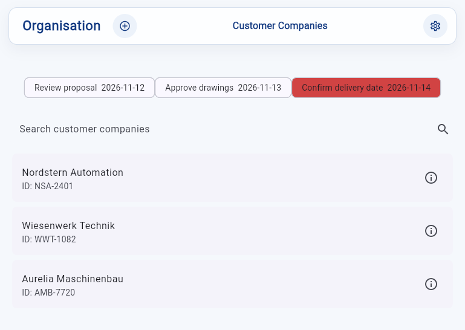
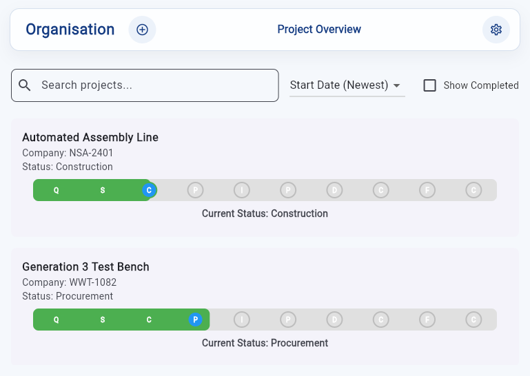
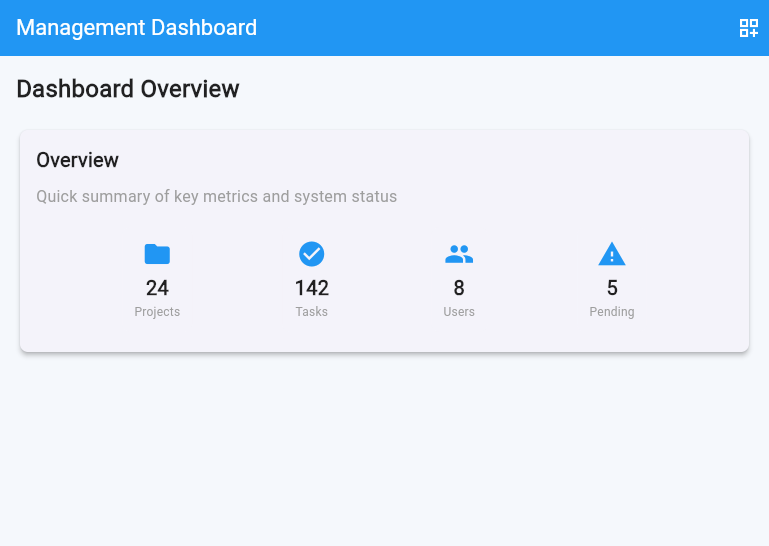

# OpenM

Kunden-, Projekt- und Produktionsmanagement: Kundenverwaltung, Projektplanung
(Gantt), Dokumentenablage, Aufgaben, Beschaffung und Produktion in einer
gemeinsamen Oberfläche. Mehrere Organisationen (Mandanten) werden von einem
Super-Admin verwaltet.

> OpenM befindet sich in aktiver Entwicklung.

## Einblicke in die Anwendung

Die folgenden Aufnahmen zeigen die echte Oberfläche mit **fiktiven
Beispieldaten**. Es werden keine Kundendaten aus einer laufenden Instanz
verwendet.

### Kundenunternehmen und Aufgaben



### Projektübersicht und Fortschritt



### Management-Dashboard



## Funktionen

- Kundenunternehmen, Ansprechpartner und projektbezogene Dokumente verwalten.
- Projekte vom Angebot bis zur Abnahme verfolgen und ihren Fortschritt anzeigen.
- Angebote als PDF erzeugen, die Angebotsliste öffnen und ausgewählte Angebote
  an Kundenkontakte senden.
- Aufgaben, Kalender, Gantt-Planung, Beschaffung und Produktion unterstützen.
- Mitarbeitende, Rollen, Vorlagen und Workflows zentral administrieren.

Einige Funktionen, insbesondere Produktionskennzahlen und Zeiterfassung,
befinden sich noch in Entwicklung. Das Dashboard enthält teilweise
Beispielkennzahlen.

## Inhalt

| Ordner | Beschreibung |
|---|---|
| [`OpenM_backend_python/`](OpenM_backend_python) | FastAPI-Backend mit SQLite |
| [`OpenM_frontend_flutter/`](OpenM_frontend_flutter) | Flutter-App (Web/Desktop) – ausführliche Doku in der [README](OpenM_frontend_flutter/README.md) |
| [`deploy/`](deploy) | Docker-Builds, Compose und nginx für den Serverbetrieb |
| `start_openm.bat` | Startet Backend und Frontend lokal (Windows) |
| `build_server.bat` | Erstellt das Serverpaket `dist/openm-server` |

## Voraussetzungen

- Python 3.13+
- Flutter SDK (Web aktiviert)
- Optional: [`uv`](https://docs.astral.sh/uv/) und LM Studio für den KI-Chat-Assistenten
- Für den Serverbetrieb: Docker mit Compose

## Lokal starten (Windows)

```powershell
python -m venv .venv
.\.venv\Scripts\python.exe -m pip install -r OpenM_backend_python\requirements.txt
.\start_openm.bat
```

Das Backend läuft auf `http://localhost:8002`, das Frontend startet in Chrome.
Die Datenbank (`OpenM_backend_python/database/openm.db`) wird beim ersten Start
automatisch angelegt.

## Erste Einrichtung

Beim ersten Start zeigt die App einen Einrichtungsbildschirm. Das dort
angelegte Konto ist der **Super-Admin**: Er legt die erste Organisation an und
kann weitere Organisationen (optional mit eigenem Administrator) hinzufügen.
Administratoren einer Organisation sehen und verwalten nur ihre eigene
Organisation. Es gibt keine voreingestellten Zugangsdaten.

## Mit Docker starten

Mit laufender Docker Engine und Compose kann das Repository direkt gebaut
und gestartet werden; ein lokal installiertes Flutter SDK ist dafür nicht
erforderlich:

```shell
docker compose -f deploy/docker-compose.source.yml up -d --build
docker compose -f deploy/docker-compose.source.yml ps
```

Die App ist anschließend unter `http://localhost` erreichbar. Der erste Build
kann wegen des Downloads von Flutter und Python-Abhängigkeiten länger dauern.
Optional `deploy/.env.example` nach `deploy/.env` kopieren und den Port oder
Signaturschlüssel anpassen. Daten liegen dauerhaft unter `deploy/data/`.
Für den Internetbetrieb ist ein HTTPS-Reverse-Proxy notwendig.

## Vorgebautes Serverpaket

```powershell
.\build_server.bat
```

Den Ordner `dist/openm-server` auf den Server kopieren und dort
`docker compose up -d --build` ausführen. Das Skript überschreibt kein
vorhandenes Ausgabe-Verzeichnis. Für weitere Builds kann ein neuer Zielpfad
angegeben werden, zum Beispiel `.\build_server.bat dist\openm-server-neu`.
Details zu beiden Varianten, Updates, Backups, HTTPS und Einschränkungen stehen
in [`deploy/README.md`](deploy/README.md).

## Tests

```powershell
cd OpenM_backend_python
..\.venv\Scripts\python.exe -m pytest tests\test_initial_setup.py tests\test_super_admin.py

cd ..\OpenM_frontend_flutter
flutter test
```

## Konfiguration

| Variable | Bedeutung |
|---|---|
| `OPENM_SECRET_KEY` | JWT-Signaturschlüssel (mind. 32 Zeichen). Ohne Angabe wird einmalig einer erzeugt und in `database/` gespeichert. |
| `OPENM_STORAGE_ROOT` | Speicherort für hochgeladene Dateien (siehe [`HOWTO_STORAGE_AND_MIGRATION.md`](OpenM_backend_python/HOWTO_STORAGE_AND_MIGRATION.md)) |
| `API_BASE_URL` | Build-Zeit-Option des Frontends (`--dart-define`), Adresse des Backends |

Datenbanken, Signaturschlüssel und Uploads gehören nicht ins Repository
(siehe `.gitignore`).

## Lizenz

Für dieses Projekt ist derzeit keine Lizenz festgelegt. Vor einer
Veröffentlichung sollte eine passende Lizenzdatei ergänzt werden.
